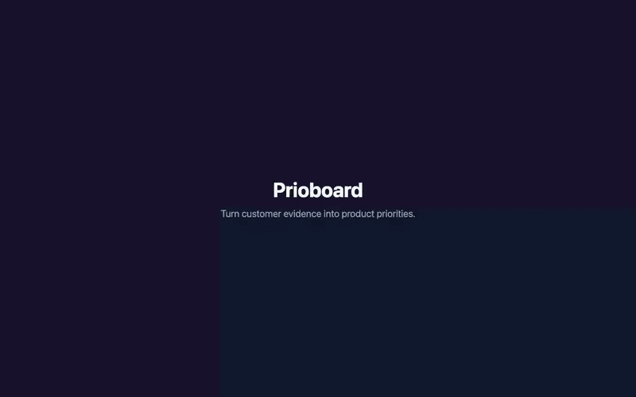

# Prioboard



A self-contained multiplayer priority board with Markdown/YAML validation, evidence browsing, calculated ranking, persistent priority overrides, comments, and ZIP export. Source, tests, and a sample dataset are included; no sibling projects or original checkout are required.

## Run locally

Requires Node.js 22.13+, npm, and the Applet CLI (`@applet-one/cli`).

```sh
cd prioboard
npm ci
npm run dev
```

Open the URL printed by Applet in multiple browsers (normally `http://127.0.0.1:8787`). Each browser profile has its own selected identity. Use separate browser profiles or incognito windows to try multiple users; ordinary tabs in the same browser share the identity cookie. Local data persists in `.applet/dev/`. This copy starts with no saved database or hosted app ID. The included `data/` folder is a sample dataset to upload, not automatically loaded application state.

## People and permissions

On first visit, select a previously registered person or enter a first and last name. **Markus Andrezak** is pre-listed and is the admin. Equivalent names, ignoring case and redundant whitespace, reuse the same person rather than creating duplicates. Both name fields are required, with a maximum of 80 characters each.

The bottom-left profile card shows a circular initials avatar with a stable per-person color, full name, and **Admin** for Markus. Click the card to switch people. On small screens it remains at the bottom left in a fixed footer.

- **Everyone:** browse the board, inspect sources, download the dataset, and post comments. Comments show the same colored initials avatar, the author's name, and a relative timestamp (for example, “2 h ago”). Hover the timestamp for the full local date/time. Relative labels refresh every 30 seconds without disturbing drafts.
- **Markus only:** delete any comment, create/edit/remove priority overrides, and upload or replace the dataset.

Permissions are checked on the server, not just by hiding buttons. The server derives comment authors from an opaque HttpOnly session cookie, not the submitted comment body.

**This is deliberately a passwordless trusted demo, not verified authentication. Anyone can select Markus and become admin.** Names and the shared name picker are visible to everyone with access. The included `applet.jsonc` configures public hosting. Set `access` to `private` before deploying sensitive data and use Applet hosting access controls as the outer access boundary. Do not use name selection as a security mechanism for an untrusted group.

## Live collaboration

Browsers check a shared SQLite revision approximately every 1.5 seconds. Comments, deletions, priority changes, and dataset uploads appear automatically, without a manual refresh. Unchanged checks return only the revision, not the dataset. A lost connection shows **Reconnecting…** and retries automatically.

Comment drafts, the active opportunity, expanded scorecards, and the comment caret are retained during incoming updates. Sync waits while an upload, comment write, or dialog is active. Stale priority decisions are rejected rather than silently overwriting another decision; dismiss the dialog, allow the latest board to sync, and retry. Drafts remain local to the current page session.

## Upload and download

1. Join as **Markus Andrezak**.
2. Choose **Upload folder** and select the included **`data/`** folder, not the project root.
3. Confirm the upload. Only Markdown under `context/`, `input/`, and `output/` is saved.
4. To refresh the evidence/reports, choose **Replace dataset** and select the complete folder again. Every connected browser receives the new snapshot.

Uploads transactionally replace the entire saved snapshot, including removing absent files. Limits: 1,000 Markdown files, 5 MiB per file, 25 MiB total text, and 32 MiB encoded JSON. Invalid uploads retain the previous snapshot. Cross-origin writes are rejected.

Priority overrides pin an opportunity to absolute position 1, 2, or 3 and require a reason of up to 2,000 characters. Calculated scores and original files are never modified. Other pinned positions stay fixed. Unpinned cards fill the gaps in score order. Overrides survive identical reuploads, but changed run reports, inputs, or context clear that run's overrides.

Comments are plain text, up to 2,000 characters. Dataset replacements retain comments when the same run/opportunity remains in a valid scorecard, even if evidence changes; missing opportunities or invalid scorecards remove their threads transactionally. Only Markus can delete comments, including his own. Deletion is permanent.

**Download dataset** exports only original Markdown paths and contents in a ZIP, not users, sessions, comments, or manual overrides. Extract it before uploading again; ZIP uploads are not supported. Keep appropriate exports/backups before destructive changes.

## Test

```sh
npm test
npm run check
npm run test:browser
```

Browser tests use Playwright and an isolated local Applet runtime/database. On macOS they use installed Google Chrome; elsewhere install Chromium with `npx playwright install chromium`, or set `CHROME_PATH`. Tests include independent admin/member browser contexts, live comments/deletion/uploads/priorities, draft preservation, server-side permission checks, names/initials, persistence, priority conflicts, upload rollback, ZIP round-trips, CSP, injection safety, and mobile layout.

Use `npm run format` to format source files. If running through an npm wrapper from the repository root confuses the Applet CLI's directory detection, run commands directly from this directory with `APPLET_INIT_CWD="$PWD" INIT_CWD="$PWD"`.

## Deploy

```sh
applet login
npm run deploy
```

The copy has no existing hosted app ID or copied local database. `applet.jsonc` currently requests **public** hosting for a new deployment, matching the source configuration. For private hosting, change it to `{ "access": "private" }` before deploying. Inspect hosted access with `applet access`; do not make private customer data public. Code deployment does not upload a dataset.

## Layout

- `app.js`: Durable Object entry, assets, security headers.
- `client/components/profile.js`: passwordless name picker and profile card.
- `client/collaboration.js`: live revision polling and state reconciliation.
- `client/components/comments.js`: named comment threads and admin deletion.
- `server/identity.js`: persistent people, sessions, admin role, shared revision.
- `server/routes.js`: same-origin APIs and permission enforcement.
- `server/storage.js`: original file storage, decisions, and comments.
- `shared/`: unchanged report validation, upload policy, and ranking.
- `scripts/build.js`: bundles browser assets into `generated/assets.js`.
- `tests/`: unit/SQLite and browser integration coverage.
- `data/`: bundled sample Markdown dataset used by tests and available for manual upload.

Generated assets, dependencies, and local Applet state are git-ignored.
