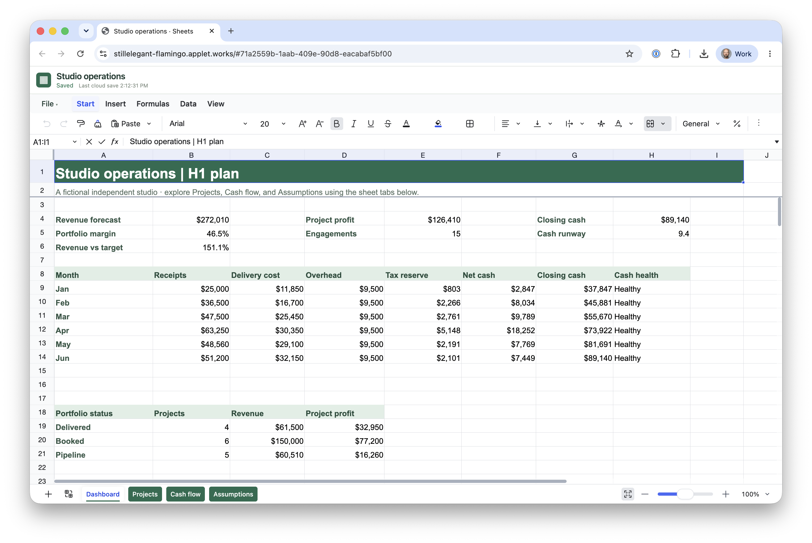

# Single-player sheets



A self-contained **Applet.one example** of a single-player spreadsheet using published, open-source [Univer](https://univer.ai/) packages. Opens directly in the editor, with a File menu, browser-side formulas, revision-safe autosave, and IndexedDB recovery. No sibling checkout, Pro packages, D1 database, external services, or authentication required.

**No authentication means no privacy or ownership isolation. Anyone who can reach this app can read, edit, duplicate, and delete every workbook.** “Single-player” describes the editing model, not access control. Do not put sensitive data in this public example.

## Run

Requires **Node.js 22.13+**, npm, and Applet CLI **0.4.6+**:

```sh
npm install -g @applet-one/cli
cd single-player-sheets
npm ci
npm run dev
```

Open the URL printed by Applet (normally `http://127.0.0.1:8787`). The app opens the most recently saved workbook immediately, or creates a blank spreadsheet if none exists. A workbook URL (`#workbook-id`) opens that workbook directly. There is no landing page.

Use **File → New blank spreadsheet**, **Open workbook…**, **Save now**, **Save as copy…**, or **Rename…**. The Open workbook dialog lists saved workbooks and browser recovery copies, and supports rename, duplicate, and delete without leaving the editor. **File → Try the studio example** creates an optional **Studio operations** workbook with four connected worksheets: a KPI dashboard, a 15-engagement project-profitability tracker, a six-month cash-flow forecast, and editable planning assumptions. Yellow cells are inputs; formulas calculate rates, delivery costs, margins, pipeline-weighted revenue, tax reserves, cash balances, and runway. Try changing the hourly rate, overhead, scenario multiplier, or pipeline probability and watch the other sheets recalculate. All figures are fictional USD planning data; existing saved workbooks are never replaced. Local SQLite state survives process restarts in `.applet/dev/`.

```sh
npm run check       # build assets, audit OSS inputs, validate Applet artifact
npm test            # save coordinator, SQLite storage, request contracts
npm run test:browser # isolated real Applet/workerd + Playwright integration tests
```

Browser tests use installed Google Chrome on macOS; elsewhere run `npx playwright install chromium`. Set `CHROME_PATH` to override the browser executable. Tests copy the app to a temporary project and do not touch your development database. `KEEP_TEST_PROJECT=1 npm run test:browser` retains the test project and screenshot for inspection. Deliberately aborted requests print expected browser network errors.

If using an npm wrapper from another directory confuses the Applet CLI, run with `APPLET_INIT_CWD="$PWD" INIT_CWD="$PWD"` from this directory.

## What it demonstrates

- Direct blank/latest-workbook startup, plus a File menu and in-app workbook picker: create, open, save, save as copy, rename, duplicate, and confirm deletion.
- Multiple worksheets, formulas, formatting and number formats, merged cells, frozen panes, undo/redo.
- OSS sorting, filtering, validation, conditional formatting, find/replace, hyperlinks, and notes presets, including CSS and English locales.
- Full native Univer snapshots, including plugin `resources`; editor code and calculations stay in the browser.
- Autosave after roughly one idle second, with a five-second maximum debounce during continuous edits. Explicit **Save now** and **Ctrl/Cmd+S** use the same coordinator.
- Visible save state and last cloud acknowledgement time.
- Safe retries of the **same payload and mutation ID**, with exponential backoff and jitter.
- Revision conflicts pause saving rather than overwriting a newer cloud snapshot.
- Browser recovery records and cached reopening when the API is unreachable.

Univer is a desktop-oriented editor. The workbook picker and app-owned controls support small screens; the spreadsheet keeps its own scrolling and toolbars rather than pretending to be a fully mobile-native spreadsheet.

## Pure Applet architecture

```text
Browser: small vanilla-JS shell + lazy-loaded Univer OSS editor
   | same-origin JSON API
   v
Applet Worker → APPLET_STATE / “default” Durable Object
                   └─ SQLite catalog + snapshot chunks + save receipts
```

This deliberately adapts the source plan rather than reproducing its standalone React/Vite/D1/per-workbook-DO architecture. **One Applet, one SQLite-backed Durable Object** is sufficient for this example. Catalog metadata, snapshots, revisions, renames, deletes, and receipts are updated in synchronous SQLite transactions; no cross-store provisioning/reconciliation workflow is needed. The default Worker export forwards requests to the same named object in local and hosted environments.

The Worker embeds the browser build as static strings, following the examples' self-contained Applet pattern. It does not instantiate Univer on the server. `npm run build` checks browser build inputs for `@univerjs-pro/*` and writes ignored `generated/assets.js`. All Univer dependencies are pinned to **1.5.2** and `package-lock.json` is committed.

### Files

- `app.js`: Worker routing, Applet Durable Object, embedded assets, response headers.
- `server/store.js`: transactional catalog/content storage, revisions, receipts, tombstones.
- `server/routes.js`: bounded requests, origin checks, HTTP API.
- `shared/contracts.js`: runtime envelope/structural snapshot checks and blank workbook model.
- `shared/csv.js`: bounded CSV parsing, safe cell typing, and active-sheet value export.
- `shared/sample-workbook.js`: four-sheet studio planning example.
- `client/editor.js`: preset composition, public Facade integration, editor disposal.
- `client/persistence.js`: save coordinator and IndexedDB adapter.
- `client/main.js`, `styles.css`: File menu, workbook picker, editor shell, dialogs, recovery UI.
- `scripts/build.js`: esbuild browser bundles and embedded assets.
- `tests/`: Node unit/SQLite tests and real browser/local-runtime tests.

No SDK checkout or workspace linking is used. This is an independent npm example.

## Persistence and concurrency

Each workbook has a server-generated ID and an application revision starting at 1. Saves require the current revision, a mutation ID, application schema version **1**, and Univer version **1.5.2**. Supported snapshots are structurally validated; the backend treats cell contents and plugin resources as opaque JSON, not executable commands. This is not a comprehensive validator for every Univer model field.

The save transaction checks tombstones and mutation receipts, compares the revision, replaces snapshot chunks, increments the revision, and records the receipt without yielding. Receipt hashes reject mutation-ID reuse with different content. Retries return the original revision, even if another save has since advanced the workbook. Receipts are retained for **seven days or the newest 1,000 saves per workbook**, whichever is smaller. After expiry a stale revision still prevents an overwrite, but a long-delayed retry may need recovery as a copy.

Cloud saves and local writes capture their local edit generation. Acknowledging one save cannot mark edits made during that request as saved. Late formula results after an edit produce another dirty generation, without blocking recovery of the original formula indefinitely. Public command events track mutations, not selection/scroll operations; internal `onlyLocal` bookkeeping and formula-result application are excluded, and the public formula-result-applied callback handles calculated values.

Renaming increments the revision. The catalog title is authoritative and is reconciled into snapshots on load/save. Renaming the current workbook updates its editor title and acknowledged revision; another tab may therefore conflict after a rename, intentionally. Workbook duplication changes the root workbook ID; workbook-local sheet/style/resource identities are preserved, not globally string-replaced.

### Limits

- Maximum JSON **request body: 5 MiB**, streamed and enforced on client and server. The envelope counts toward this limit, so usable snapshot space is slightly smaller.
- 1–100 worksheets per snapshot; worksheet dimensions bounded to 1,000,000 rows and 16,384 columns. These are validation bounds, not performance guarantees. Start with modest workbooks.
- Snapshots split into 64,000-code-unit SQLite chunks, avoiding split Unicode surrogate pairs and keeping individual rows well below platform string limits.
- No XLSX import/export, commercial plugins, charts, attachments, collaborative editing, automatic merges, or user-facing cloud version history. CSV import/export is supported with the limits below.
- No automatic SDK snapshot migrations. Keep dependency versions pinned; before upgrading, back up state and test representative workbooks and plugin resources against the new version. Old clients with mismatched envelope versions are rejected.

## Recovery, offline use, and conflicts

Local snapshots debounce separately (200 ms, at most one second during continuous edits). Writes are serialized. Pending cloud requests are retained verbatim alongside the latest local snapshot, base revision, edit generations, and timestamp.

Recovery keys include the workbook ID and **a unique editor session ID**, so another tab or a later open route cannot overwrite an earlier session's unsaved recovery. The Open workbook dialog's **On this browser** section lists these records, including clean cached copies. Original recovery records are retained after restore/copy; remove obsolete records explicitly with **Remove local copy**. Nothing is silently merged or automatically garbage-collected.

On open:

- If local unsaved edits match the cloud revision, choose **Restore local edits**, save the recovery as a copy, or open the cloud version.
- If the cloud has advanced, preserve the recovery as a new workbook or open the cloud version. Restoration never silently rebases onto the newer revision.
- If the API cannot be reached and a cache exists, the editor opens that cache with an explicit offline message. Existing edits retry when connectivity returns. New cloud workbooks require connectivity.
- After a stale save, **Preserve as new workbook** saves local content independently; **Reload cloud version** asks for confirmation. The original recovery record remains available.

This is **not an offline-installable PWA**: there is no service worker, so the app shell/assets must still be available (or already loaded) to reopen a cached workbook. IndexedDB can fail, fill up, be evicted, or be cleared. A warning is displayed if local recovery cannot be written; successful cloud saves still work. Browser shutdown can interrupt both network and local writes. `beforeunload` is only a warning, not a durability mechanism. Check **Saved** before relying on cloud persistence.

## CSV import and export

- **File → Import CSV…** creates a **new workbook** from a UTF-8 CSV/TSV file; it never replaces the current workbook. Comma, semicolon, and tab delimiters are supported, with automatic detection from the first record or an explicit override. Quoted delimiters, doubled quotes, multiline fields, BOMs, and CR/LF line endings are supported. Malformed files show an error without creating a workbook.
- Plain decimal-point numbers become numeric cells. Leading-zero identifiers, numbers over 15 digits, dates, and other text remain strings. Formula-like text such as `=SUM(A1:A2)` is imported as **literal text**, never executable formulas. Decimal commas, localized currencies, and date inference are intentionally not guessed.
- **File → Export CSV…** downloads the **active worksheet**, using unformatted underlying values and calculated formula results. Formula calculation is awaited (up to five seconds); unavailable formula results produce an error rather than a misleading blank value. Rich-text cells export their plain text. The filename includes workbook and worksheet names.
- Exports use commas, quoted fields as needed, CRLF line endings, and a UTF-8 BOM for spreadsheet-app compatibility. To reduce CSV formula-injection risks when opened elsewhere, formula-like **text** is prefixed with an apostrophe; real numeric values remain numeric. This safety transformation intentionally changes those text fields and is not an exact round trip.
- CSV cannot preserve formulas, styles, number formats, merges, notes, validation, or multiple worksheets. Only the populated rectangular data area is exported; trailing empty rows/columns and formatting-only cells are omitted. CSV is interchange, not a full-workbook backup.
- Import and export are limited to **5 MiB**, **50,000 rows**, **1,000 columns**, and **200,000 cells in the rectangular data area**. Sparse distant cells can exceed that area limit. An imported native JSON snapshot must also fit the existing 5 MiB API request limit, so heavily quoted or many-cell CSV files can hit that limit before 5 MiB of source text. The local file and existing workbook are unchanged if import fails.

## API

All routes are under `/api/workbooks`:

| Method | Path                           | Operation                                                                   |
| ------ | ------------------------------ | --------------------------------------------------------------------------- |
| GET    | `/api/workbooks`               | List active metadata                                                        |
| POST   | `/api/workbooks`               | Create `{ title, snapshot }`                                                |
| GET    | `/api/workbooks/:id`           | Read metadata, revision, snapshot and versions                              |
| PUT    | `/api/workbooks/:id/snapshot`  | Save `{ baseRevision, mutationId, schemaVersion, univerVersion, snapshot }` |
| PATCH  | `/api/workbooks/:id`           | Rename `{ title, baseRevision }`                                            |
| POST   | `/api/workbooks/:id/duplicate` | Duplicate committed content, body `{}`                                      |
| DELETE | `/api/workbooks/:id`           | Tombstone `{ baseRevision }`                                                |

Mutations require JSON. Unexpected browser origins/fetch-site headers are rejected; non-browser clients without an Origin header can call the API. These checks reduce browser cross-site mutation risks and **are not authentication**. No CORS access is granted. The CSP disallows external script execution, objects, and framing; inline styles are allowed for Univer. Spreadsheet content and credentials are not logged.

## Deploy and back up

```sh
applet login
npm run deploy
applet backup
```

`applet.jsonc` explicitly selects **public** access, per this example's no-authentication requirement, and configures the `APPLET_STATE` / `default` backup target. No hosted app ID or local database is included. Preserve existing Worker names, bindings, migrations, and named-object identity on subsequent deployments.

Applet-managed backups cover the catalog, snapshot chunks, tombstones, and receipts in this one object; browser IndexedDB is separate. Download backups before destructive operations or upgrades, and keep them outside the project. This example's tests verify local process-restart persistence, **not a hosted disaster-recovery/restore drill**. Verify the current Applet hosting backup/restore procedure and platform limits before production use. Autosave is not a backup policy.

To prevent public access to a real deployment, use Applet hosting access controls and change `access` to `private` before deploying; the application itself still has no per-user authentication or authorization. Never leave the example publicly reachable with confidential workbooks.

## Verification coverage

Unit tests cover edits during saves, stable retry payloads, recovery write ordering, local storage errors, CRUD, stale revisions, receipts, tombstones, transaction rollback, body limits, version validation, and cross-origin rejection. Browser tests run against a real local Applet runtime and cover concurrent saves, lost responses, process restart persistence, editing/formula calculation, autosave/reopen, conflicting tabs, recovery-as-copy, offline writes, recovery after page reload, direct blank/latest startup, File-menu create/open/save-as-copy, workbook management, mobile layout overflow, and CSV import/download with delimiter overrides, multiline quoting, calculated values, safe formula-like text, and invalid-file handling.

An additional browser round trip uses the integration module's public Facade APIs to create sheets, merges, formats, frozen rows, filters, sorting, validation, conditional formatting, notes, and hyperlinks; it saves through the API, duplicates to a new workbook ID, disposes, and restores with the same preset set. Find/replace and every toolbar/keyboard combination are not exhaustively automated. Hosted deployment, load profiling, quota exhaustion, OS-level crash behavior, and production backup restoration remain outside this example's automated coverage.
